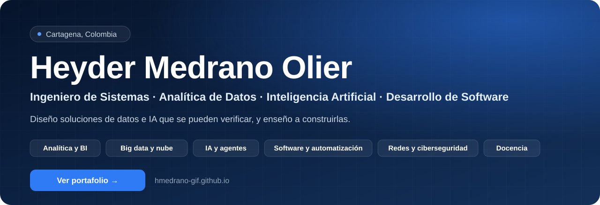

  <a href="https://hmedrano-gif.github.io"><b>Portafolio</b></a> &nbsp;·&nbsp;
  <a href="https://hmedrano-gif.github.io/CURN/"><b>Materiales de clase (CURN)</b></a> &nbsp;·&nbsp;
  <a href="https://github.com/hmotecnologico-create"><b>Proyectos</b></a>

## Proyectos destacados

<table>
<tr>
<td width="33%" valign="top">

**[ClinDoc Agent](https://github.com/hmotecnologico-create/Clindoc_agent)** 
IA Y AGENTES · TRABAJO FIN DE MÁSTER

Auditoría documental de expedientes clínicos con un sistema multiagente que funciona **100 % en local**.

`Python` `LangGraph` `Qdrant` `Ollama`

</td>
<td width="33%" valign="top">

**[Agente de auditoría ISO 27001](https://github.com/hmotecnologico-create/Agente-de-auditor-a-27001)** 
CIBERSEGURIDAD · [DEMO EN VIVO](https://agente-de-auditor-a-27001.vercel.app)

Matriz de cumplimiento normativo a partir de documentos, con OCR y un LLM local.

`TypeScript` `React` `Ollama`

</td>
<td width="33%" valign="top">

**[Tecnologías de Procesamiento de Datos](https://hmedrano-gif.github.io/CURN/tpd/)** 
DOCENCIA · POSGRADO

Hadoop, Spark, Kafka y BigQuery con 19,9 millones de viajes reales: las tres tecnologías dan la misma cifra al centavo.

`Spark` `Kafka` `BigQuery` `Power BI`

</td>
</tr>
<tr>
<td valign="top">

**[HMO Auditor](https://github.com/hmotecnologico-create/HMO_AUDITOR)** 
CIBERSEGURIDAD

Asistente de auditoría de sistemas de gestión según la ISO 19011, con IA local.

`Python` `Streamlit` `Ollama`

</td>
<td valign="top">

**[Entorno big data en Codespaces](https://github.com/hmedrano-gif/tpd-codespace)** 
DATOS Y BIG DATA

Hadoop, Spark y Kafka listos en minutos para cada estudiante, sin instalar nada.

`Docker` `Dev Containers` `Bash`

</td>
<td valign="top">

**[Power BI para la gestión pública](https://github.com/hmotecnologico-create/PowerBI-Gestion-Publica-Cartagena)** 
DOCENCIA · DATOS ABIERTOS

Seguimiento del Plan de Desarrollo con datos abiertos, para servidores públicos.

`Power BI` `Power Query` `DAX`

</td>
</tr>
</table>

## Trayectoria

| Desde | Dónde | Qué hago |
|---|---|---|
| 2026 | Especialización en Analítica de Datos (CURN) · UNICOLOMBO | Docente de posgrado y educación continua: big data, nube y Power BI |
| 2006 | SENA | Instructor de informática y telecomunicaciones, diseño curricular y mentoría MinTIC 2026 |
| 2023 | ALDESARROLLO · Proyecto Canal del Dique | Tableros en Power BI, ETL con SQL y modelos predictivos en Python |
| 2011–2021 | Universidad de Cartagena | Docente de educación superior |
| 2004–2018 | UNAD · Alma Máter · SAII Consulting · Indumats | Ingeniería de sistemas, redes y tutoría virtual |

**Certificaciones:** Microsoft Technology Associate (Networking Fundamentals) · Panduit Network Infrastructure · Diplomado en Comunicaciones y Redes · Tutor virtual en Moodle y Blackboard

## Tecnologías

| Área | Herramientas |
|---|---|
| **Datos y BI** | Python · pandas · scikit-learn · SQL · Power BI · DAX |
| **Big data y nube** | Hadoop · Spark · Kafka · BigQuery · Google Cloud · Azure · Docker |
| **IA** | LangGraph · RAG · Qdrant · Ollama · Streamlit |
| **Software** | TypeScript · React · Astro · Django · Git · GitHub Actions |
| **Redes y seguridad** | Cisco · Seguridad en redes · ISO/IEC 27001 |

## Docencia

**▶ [Materiales de clase · Especialización en Analítica de Datos (CURN)](https://hmedrano-gif.github.io/CURN/)** · [repositorio](https://github.com/hmedrano-gif/CURN)

Diseño los materiales de las asignaturas que dicto con datos reales y resultados comprobables: Tecnologías de Procesamiento de Datos (posgrado), Power BI aplicado a la gestión pública, el diplomado y las electivas de análisis de datos, y la mentoría del concurso MinTIC Datos al Ecosistema 2026.

Las instituciones se mencionan como contexto académico. Los repositorios y materiales son de mi autoría.
